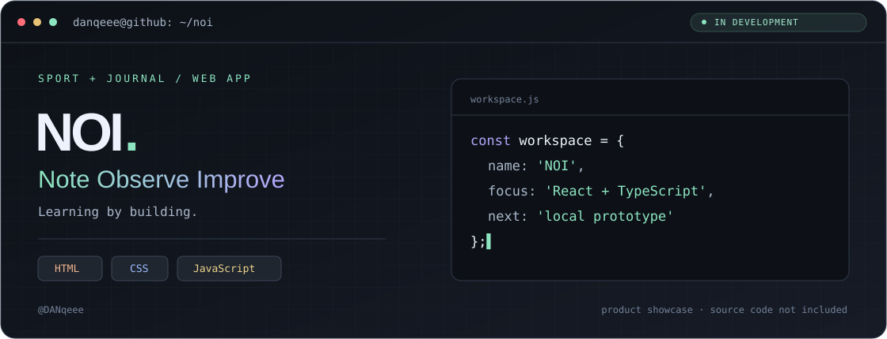

# NOI

**Личное пространство для спортивных целей и дневника сделок.**

Русскоязычное веб-приложение: отслеживание прогресса в спорте и осмысленный разбор торговых решений в одном интерфейсе. Личный проект в активной разработке, сейчас — локальный прототип.

> Этот репозиторий — публичная витрина проекта. Здесь размещены описание и иллюстрация. Исходный код, внутренняя документация, конфигурация и пользовательские данные не публикуются.

## Что уже реализовано

- **Аккаунт и профиль:** регистрация, парольный вход, выбор дисциплин, настройка второго фактора и управление сессиями.
- **Спорт:** числовые цели и чек-листы, дневные результаты, история планов, карта активности, серии и рекорды.
- **Дневник сделок:** список и фильтры, карточка исполнения, отдельные причины входа и выхода, сохранение разбора с обработкой конфликтов.
- **Адаптивный интерфейс:** общая навигация, мобильная нижняя панель и рабочие экраны для компьютера.

## Фронтенд

**React · TypeScript · Vite · CSS**

Работа с типизированным API, формами и валидацией, загрузкой и пустыми состояниями, конфликтующими версиями данных. Локальные спортивные черновики сохраняются в IndexedDB. Интерфейс различает отсутствие данных и нулевой результат.

Серверная часть: Node.js, Fastify, PostgreSQL-совместимое хранение; локально используется PGlite. Денежные значения передаются decimal-строками и рассчитываются на сервере.

## Проверки

В проекте используются строгая проверка TypeScript, линтер, доменные и серверные тесты, браузерные сценарии Playwright для мобильного и большого экрана. Это проверки разработки, а не независимый аудит безопасности.

## Текущий статус

Рабочие локальные срезы аккаунта, спорта и дневника реализованы. Настоящая доставка почты, Google-вход и биржевой импорт требуют внешней настройки и отдельной приёмки. Приём биржевых ключей пока выключен; приложение не отправляет торговые заявки. Полная офлайн-PWA и финальная визуальная приёмка ещё впереди. Публичная демонстрационная версия не развёрнута.

---

**[Профиль разработчика](https://github.com/DANqeee)** · **[Связаться](https://vk.com/levi23321)**
